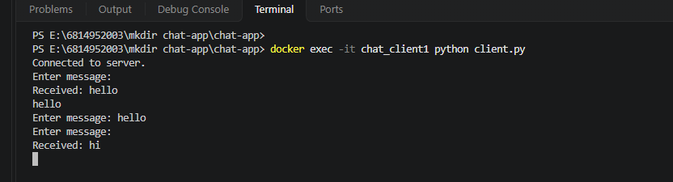
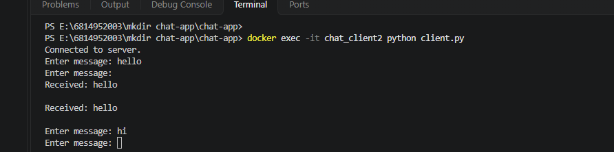
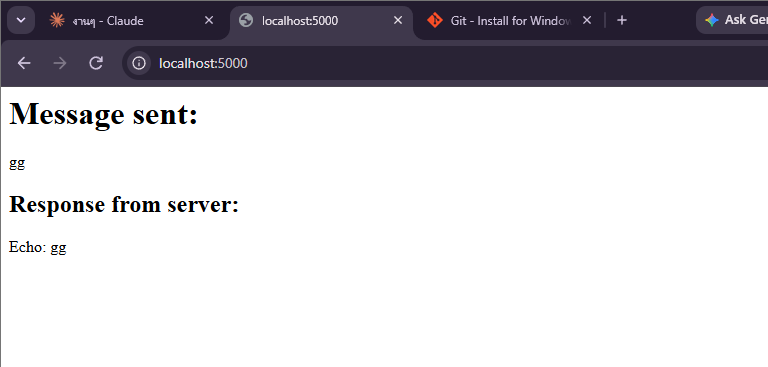

# รายงานแบบฝึกหัด Socket API & Docker (Assignment 1 & 2)

**ข้อมูลผู้จัดทำ**
- ชื่อ-นามสกุล: [์Natnapon_Taweetam]
- รหัสนักศึกษา: 6814952003
- กลุ่ม/เซคชัน: [sec2]

---

## แบบฝึกหัดที่ 1: ระบบ Chat ด้วย Docker (2 Clients & 1 Server)

### คำอธิบาย
ระบบแชทที่ใช้ Socket API แบบ TCP ด้วย Python โดยมี Server 1 ตัวทำหน้าที่รับและส่งต่อ (broadcast) ข้อความให้ Client อีก 2 ตัว ทุกส่วนรันเป็น Docker container ผ่าน Docker Compose

### วิธีรัน
```bash
cd exercise-1
docker compose up --build
```
เปิด Terminal ใหม่ 2 หน้าต่าง:
```bash
docker exec -it chat_client1 python client.py
docker exec -it chat_client2 python client.py
```
ปิดระบบ: `docker compose down`

### ผลลัพธ์
Client 1:



Client 2:



---

## แบบฝึกหัดที่ 2: Flask Web App + Socket Server

### คำอธิบาย
เว็บแอปพลิเคชัน Flask รับข้อความจากฟอร์ม (POST) แล้วส่งไปยัง Socket Server ผ่าน socket จากนั้นรับคำตอบ (Echo) กลับมาแสดงบนหน้าเว็บ แยกเป็น 2 containers

### วิธีรัน
```bash
cd exercise-2
docker compose up --build
```
เปิดเบราว์เซอร์ที่ http://localhost:5000 ปิดระบบ: `docker compose down`

### ผลลัพธ์s


---

## โครงสร้างโฟลเดอร์
```
my-socket-assignment/
├── exercise-1/
├── exercise-2/
└── images/
```